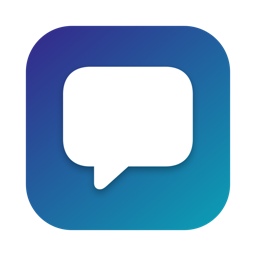
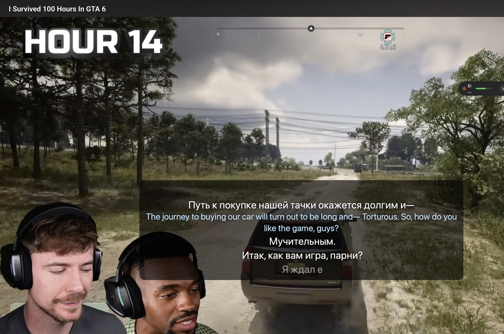

<p align="center"></p>

<h1 align="center">Subveil</h1>

<p align="center">
Hear any language, read it in yours.<br>
Live translated subtitles on top of everything on your Mac — videos, calls, meetings, meetups.
</p>

<p align="center">
  
  <br><sub>A Russian-dubbed video, translated into English live (shown here in “original + translation” mode).</sub>
</p>

> **Early alpha, now open source.** Works end to end, still rough. Progress and known gaps: [docs/TODO.md](docs/TODO.md).

## The story

Subveil was dreamed up and mostly built in one day — at the hackathon for the launch of **Claude Fable 5.2**
in **Tel Aviv on 23 November 2026** — by [Alexey Abramov](https://github.com/alexey-a-abramov), pairing with Claude Code.
It is now open to everyone.

**Where it stands:** the main paths work well in daily use. Not every engine and not every combination of engine,
translator and language has been tested yet — expect rough edges, especially with the newer cloud adapters.

## What it's for

- **Watch videos and streams in any language.** Subtitles in your language appear over the video, even in full screen.
- **Join meetings in a language you don't speak.** Just read along while the others talk.
- **Meetups and live talks.** Point it at the laptop microphone and read the translation of the speaker.
- **Everyone speaks their own language.** As long as people share one language for reading (say, English),
  everyone can talk in whatever they are comfortable with — Subveil translates it for you.

## How it works

Pick what to listen to:

| Source | Use it for |
|---|---|
| **System** | Everything your Mac plays — a video, a Zoom/Meet/Telegram call — or just one app |
| **Mic** | People in the room, a speaker at a meetup, or yourself |
| **Both** | Calls: the other side *and* you, as two separate streams — or mixed into one |

Everything is translated to **English by default**, and only the translation is shown — no text in languages you
can't read. Change the target language (or switch to two-way, e.g. RU ⇄ EN) per source, any time, without stopping.

The subtitle panel stays the size you give it: drag it anywhere, resize it from any edge, new lines come in at the
bottom and old ones fade away. Each session starts from a clean slate.

## Choose your engine

Open **Models & Providers** (menu bar, the control panel's gear, or Settings) — a full catalog of speech engines:

- **Cloud** — Soniox (the most accurate and cheapest, ~$0.12–0.18/h), Gladia, Speechmatics, OpenAI
  realtime-translate, Gemini Live Translate, ElevenLabs Scribe and Azure Speech Translation, each with your own key.
  AssemblyAI and Deepgram are listed with prices, where to get a key and where to top up.
  Step-by-step key guides for every provider: [docs/api-keys](docs/api-keys/README.md) (the app links to them too).
- **On this Mac, free and offline** — OpenAI Whisper via WhisperKit (tiny → large-v3) or Apple's on-device speech
  (macOS 26) for recognition, and **TranslateGemma / Qwen3 / EuroLLM via MLX** for translation into any of 55 languages
  (Russian and Hebrew included). Words appear while people speak; each sentence is translated as soon as it ends.
  Downloads resume after a pause or restart, are checked against SHA-256, and live only in Subveil's own folder.
- **Meeting summary** — key points, decisions and action items written on your Mac by a local model.
- **Speaker colours** and optional **spoken translation** (read aloud, never re-captured).
- **Test before you switch** — run a short clip (7 languages) through any engine: accuracy (word error rate), how many
  times faster than real time it runs, and a plain verdict on whether it keeps up with live captions. The Benchmark tab
  compares every ready engine side by side.

## Quick start

Requirements: Apple Silicon Mac with macOS 14.4+, Xcode 26 (to build), a Soniox API key.

```bash
git clone https://github.com/alexey-a-abramov/subveil.git
cd subveil
scripts/install_app.sh      # builds, signs, installs ~/Applications/Subveil.app and launches it
```

1. Paste your Soniox key when asked (it's checked live and kept in the macOS Keychain).
2. Allow the microphone and *System Audio Recording* when macOS asks.
3. Choose **System**, **Mic** or **Both** in the floating panel and press ▶.

`⌥⌘Space` start/stop · `⌥⌘H` show/hide the control panel · `⌥⌘C` show/hide subtitles.

## Privacy

Audio goes only to the provider you pick, over TLS — or nowhere at all with the offline engines — and is never saved. The key stays in the Keychain. No transcript history is kept
unless you turn it on. Recording other people may require their consent.

## For developers

`swift test` runs the test suite (a local mock Soniox server and a fake model hub, no network or key needed).
`swift run subveil-bench list | download <id> | test <id>|ready --clip ru --target en` downloads and benchmarks engines from the terminal.
Architecture and conventions: [AGENTS.md](AGENTS.md).

## Contributing

Contributions are very welcome — bug reports, test results with engines and languages we haven't tried,
new adapters, UI polish. Open an [issue](https://github.com/alexey-a-abramov/subveil/issues) or a pull request;
[docs/TODO.md](docs/TODO.md) lists what's open and [AGENTS.md](AGENTS.md) explains how the code is laid out.

## Author and license

Created by **Alexey Abramov** ([@alexey-a-abramov](https://github.com/alexey-a-abramov)).
[MIT](LICENSE) © 2026 Alexey Abramov — keep the copyright notice in copies and derived works.
Not affiliated with Soniox, OpenAI, Google, Microsoft or any other provider listed here.
